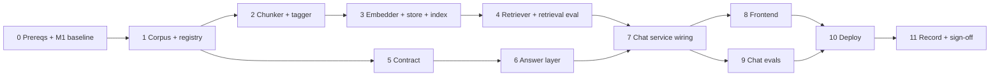

# AI Nutrition Assistant: Implementation Plan (Milestone 2: Grounded Answers)

This plan turns [featureArchitecturePlan.md](featureArchitecturePlan.md) into ordered phases of work. Each phase lists its goal, the tasks with the files they touch, the tests, and an **exit gate**. Do not start the next phase until the gate passes.

References: **FPS §x** = [featureProblemStatement.md](featureProblemStatement.md), **FAP §x** = [featureArchitecturePlan.md](featureArchitecturePlan.md), **CTX §x** = [context.md](context.md), **IP** = [implementationPlan.md](implementationPlan.md) (Milestone 1), **EC** = [edgeCases.md](edgeCases.md).

**Guiding constraint (FPS §4.6):** extend the Milestone 1 code; don't rebuild it. Every M1 rule still holds: structured outputs, strict validation, scope guards in code, failures recorded and never patched around, model calls only on the backend.

---

## Adjustments to the Architecture Plan

FAP was written against the Anthropic SDK. The code in `backend/` differs in a few places, so this plan follows the code. Each adjustment below is applied in the phase named.

| # | FAP says | The code / this plan does | Phase |
|---|---|---|---|
| A1 | `generate_grounded()` calls `client.messages.parse(..., output_format=GroundedOutput)`; Anthropic `stop_reason` checks; `usage.cache_read_input_tokens` | The model runs on **Groq** (`groq` SDK, `MODEL_ID=openai/gpt-oss-120b`) via `chat.completions.create` with `response_format={"type":"json_schema","strict":true}`. `generate_grounded()` reuses the same call path, `finish_reason` checks and failure mapping as `generate()`, with a hand-written `GROUNDED_OUTPUT_JSON_SCHEMA`. The FAP §1 note on Anthropic native citations is moot; the decision (our own label-based citations) stands | 6 |
| A2 | `Claim.source` widens to `Source \| None`; `AssistantOutput` unchanged | The M1 model-facing types are kept as **`UngroundedClaim` / `UngroundedOutput`** (`source: None`) so the `RAG_ENABLED=false` path and the existing schema-parity test still hold. `Claim` / `AssistantOutput` become the API-facing types with `source: Source \| None` | 5 |
| A3 | `retrievals.message_id` FK to the assistant message | A model failure (`502`) has no assistant message, so `retrievals` also gets a nullable **`failure_id`**. Exactly one of the two is set | 3, 7 |
| A4 | Chunk sizes measured "with the embedder's own tokenizer" | The bge `tokenizer.json` is **vendored** at `backend/corpus/tokenizer/` and loaded with the light `tokenizers` package. Chunking is then deterministic and offline in CI with no torch install. `sentence-transformers` + torch go in an optional `embed` extra, installed in Docker and in the retrieval-eval CI job only | 2, 3 |
| A5 | Citation markers `[1]`, `[2]` | The marker number **is the source label number** (`S3` → `[3]`), so a chip, a marker and the sources panel always agree | 6, 8 |
| A6 | `RAG_ENABLED=false` gives the M1 path with `system_v1` | Startup check: `RAG_ENABLED=true` requires `PROMPT_VERSION ≥ v2`, and `false` requires `v1`. A mismatch refuses to boot, like a missing prompt file does today | 7 |
| A7 | Health check blocks traffic until the index is built | `railway.json` `healthcheckTimeout` raised from 60 to **300** s, because the first boot loads the model and builds the index before uvicorn starts | 10 |
| A8 | CI secret check | Unchanged: CI already greps `.next/static` for `gsk_` (Groq keys) | — |

---

## Phase Overview

| # | Phase | Output | Depends on | Est. effort |
|---|---|---|---|---|
| 0 | Prerequisites and M1 baseline | Real-model M1 eval run committed; pgvector and Railway memory checked | none | 0.5–1 day |
| 1 | Corpus and registry | `backend/corpus/`, verified `documents.json`, loader + tests | 0 | 0.5 day |
| 2 | Chunker and tagger | Structure-aware chunks, restricted tagging, `build_report.md`, snapshot tests | 1 | 1.5 days |
| 3 | Embedder, store, migration, index build | `0002_rag`, `PgVectorStore` / `MemoryStore`, idempotent `build_index` | 2 | 1 day |
| 4 | Retriever and retrieval eval | Two retrieval modes, labelled set, calibrated k / cap / floor | 3 | 1.5 days |
| 5 | Contract | `Source`, `GroundedOutput`, envelope additions, TS types, schema tests | 1 | 0.5 day |
| 6 | Answer layer | `system_v2.md`, `generate_grounded`, citation checker, composer, new guard rules | 5 | 1.5 days |
| 7 | Chat service and API wiring | FAP §11.4 flow, `/api/documents`, health + `503`, history with sources | 4, 6 | 1 day |
| 8 | Frontend | Sources panel with chunks, citation chips, not-covered style, document filter | 7 | 1.5 days |
| 9 | Chat evals | New question groups, `expect_m2`, runner checks, first grounded run | 7 | 1 day |
| 10 | Production deploy | pgvector, new image, env vars, Railway then Vercel, prod eval run | 8, 9 | 1 day |
| 11 | Record and sign-off | Failure log M2 section, README parameters, FPS §7 ticked, `m2` tag | 10 | 1 day |

**Total: about 12 working days** for one developer. Phases 5 and 6 can run in parallel with 2–4 if two people are working.

---

## Phase 0: Prerequisites and M1 Baseline

**Goal:** M2 is measured against a real M1 baseline (FAP §0, CTX §13), and the hosting can carry pgvector and a local embedder before any M2 code depends on them.

> **Status (2026-10-26):** not started. Needs a `GROQ_API_KEY` and Railway access, which the implementer did not have. Phases 1 and 2 went ahead in parallel; their code makes no model or Railway calls.

### Tasks
- [ ] Run `python evals/run_evals.py --base-url http://localhost:8000 --repeat 3` against the **real Groq model** (not `stub-model`) with `PROMPT_VERSION=v1`. Commit the run under `evals/runs/`. Record the `MODEL_ID` used: it stays fixed for the M1-to-M2 comparison (FAP §1).
- [ ] If time allows, do the M1 Phase 10 review in `failureLog.md` now. If not, the baseline run alone is enough to start; the review happens in Phase 11 using that run.
- [ ] On the Railway Postgres service, run `CREATE EXTENSION IF NOT EXISTS vector;` from the Railway SQL console. If it fails, plan the move to Railway's **pgvector Postgres template** (FAP §15) and do it in Phase 10.
- [ ] Check the Railway plan's memory limit for the backend service. The embedder plus CPU torch needs roughly 0.5–1 GB more (FAP §15).
- [ ] Name the person who will verify the document registry (Phase 1). They need the 7 original documents to hand.
- [ ] Agree the branching rule for M2: one branch per phase (`m2-phase-2-chunker`), merged to `main` by PR with CI passing.

### Exit Gate
- A real-model M1 eval run is committed, with its `MODEL_ID` written in `evalResults.md`.
- `CREATE EXTENSION vector` works on Railway Postgres, or the migration to the pgvector template is planned.
- The Railway memory limit is known and fits.

---

## Phase 1: Corpus and Registry

**Goal:** the corpus lives inside the backend build context with a human-verified document registry, and a loader rejects anything malformed (FPS §3, FAP §4).

### Tasks
- [x] Move `Docs/blocks.json` to `backend/corpus/blocks.jsonl` (it is JSON Lines). Keep **one** copy. Update the file pointer in FPS §3 and the key-files table in CTX §14.
- [ ] Write `backend/corpus/documents.json` *(status 2026-10-26: written with candidate `title` / `publisher`, `year` and `url` left `null`, nothing verified yet; see `backend/corpus/README.md`)*: one entry per `document_id` with the FAP §4.2 fields (`title`, `publisher`, `publisher_short`, `year`, `url`, `aliases`, `publisher_aliases`, `verified_by`, `verified_on`).
  - `year` and `url` are copied **from the published document** by the named verifier. Never fill them from model memory (FPS §3.3).
  - Until verified, leave `verified_by` empty; the build refuses such entries in production.
- [x] `backend/app/config.py`: add `CORPUS_DIR` (default `corpus`) and `ALLOW_UNVERIFIED_REGISTRY` (default `false`).
- [x] `backend/app/rag/__init__.py` and `backend/app/rag/corpus.py`:
  - `Block` and `DocumentEntry` dataclasses (or Pydantic models with `extra="forbid"`).
  - `load_corpus(corpus_dir, *, allow_unverified) -> Corpus(blocks_by_doc, documents)` raising `CorpusError` with every problem listed, not just the first.
  - Checks from FAP §4.1: every line parses; `(document_id, ordinal)` unique and contiguous; registry and blocks cover the same IDs; 5 ≤ documents ≤ 7; tables have `header` and `rows` with matching cell counts; `year` is an integer and `url` is `https://`; `verified_by` set unless allowed.
  - Blocks without `page` (48 today) are accepted.
- [x] `backend/tests/fixtures/corpus/`: a mini corpus (2–3 documents, a table, a list run, a heading-only section, a block with no page) used by Phases 1–4 tests.

### Tests (`tests/test_corpus.py`)
| Case | Expected |
|---|---|
| The real `backend/corpus/` with `allow_unverified=True` | loads: 7 documents, 1,001 blocks |
| Duplicate or missing ordinal | `CorpusError` naming the document and ordinal |
| `document_id` with no registry entry, or a registry entry with no blocks | `CorpusError` |
| Table row with the wrong number of cells | `CorpusError` |
| Registry entry with empty `verified_by`, `allow_unverified=False` | `CorpusError` |
| 4 or 8 documents | `CorpusError` (FPS §6 Rule 6) |

### Exit Gate
- `backend/corpus/blocks.jsonl` and `documents.json` are committed, and `Docs/blocks.json` is gone.
- All 7 registry entries have a `verified_by`, a `year` and a working official `url`, checked by a person.
- Corpus tests pass in CI.

---

## Phase 2: Chunker and Tagger

**Goal:** turn blocks into structure-aware chunks with full citation metadata, and mark corpus content that must never be relayed (FPS §4.1, §4.5, FAP §5, §10.3).

### Tasks
- [x] Vendor the tokenizer (A4): download `tokenizer.json` from `BAAI/bge-small-en-v1.5` into `backend/corpus/tokenizer/bge-small-en-v1.5/` (MIT licence; note the source and revision in a `README` next to it). Add `tokenizers` to the main dependencies.
- [x] `backend/app/rag/tokens.py`: `count_tokens(text) -> int` using the vendored tokenizer (cached), counting the same way the embedder will (special tokens included).
- [x] `backend/app/rag/chunker.py`, `chunk_corpus(corpus, settings) -> list[Chunk]`, implementing FAP §5.2 in order:
  1. Sections: consecutive blocks sharing `heading_path`. Heading blocks give the label and never become chunks.
  2. Units: one paragraph; one run of consecutive `list_item` blocks plus a preceding lead-in paragraph ending in ":"; one table rendered as Markdown with its caption.
  3. Greedy packing to `CHUNK_TARGET_TOKENS=350`, never over `CHUNK_MAX_TOKENS=480` (counted on `embed_text`, i.e. with the context header).
  4. Oversize units: tables split by row with caption and header repeated and `(part i of n)`; list runs split between items with the lead-in repeated; paragraphs and single oversize rows split at sentence boundaries and **flagged**.
  5. Tiny sections (< `CHUNK_MIN_TOKENS=60`) merged into the next sibling under the same parent, never across documents or a level-1/level-2 heading.
  - Overlap 0. Every chunk gets the FAP §5.3 record: `chunk_id` (`<doc>#<first>-<last>` plus `.pN` for parts), registry metadata, `section_path`, `section`, `page_start`, `page_end`, `ordinals`, `kind`, `text`, `embed_text`, `token_count`.
  - Settings live in `config.py` and feed `corpus_version` (Phase 3).
- [x] `backend/app/rag/tagger.py`: data-driven `TagRule`s (ID, category, matcher on table header / caption / text) that set `restricted_category` to `calorie_target` or `weight_target`. Start with the `eatwell-guide` energy-requirements table (headers or captions matching "energy requirements", "kcal per day") and text stating weight or BMI ranges as targets. Each rule ID is `RET-CAL-NN` / `RET-WT-NN`.
- [x] `backend/app/rag/report.py`: writes `backend/corpus/build_report.md` with the chunk count per document, a token-size histogram, every split and merge, every flagged sentence split, and **every tagged chunk with the rule that tagged it**. A CLI `python -m app.rag.report` produces it without embedding (fast, no torch).
- [ ] *(status 2026-10-26: report generated, 209 chunks, 1 restricted; awaiting human review)* Review `build_report.md` by hand: are the tagged chunks right, are any tables or lists cut badly, are merges sensible? Fix the rules or settings and regenerate. Commit the report.

### Tests
**`tests/test_chunker.py`** (fixture corpus + the real corpus)
- No table is split mid-row and no list run mid-item; every split table part starts with the caption and header.
- Every chunk has `token_count ≤ 480`, measured on `embed_text`.
- A tiny section merges only with a sibling under the same parent; never across documents.
- Heading-only sections produce no empty chunk; blocks without `page` give `page_start=None`.
- Running the chunker twice gives identical `chunk_id`s and texts.
- Snapshot: the chunk count and `chunk_id` list per document for the real corpus (`tests/snapshots/chunks.json`). A change to the chunker must update the snapshot in the same PR.
- Every block ordinal appears in exactly one chunk (or in the parts of one split unit); heading blocks excepted.

**`tests/test_tagger.py`**
- The energy-requirements table chunk is tagged `calorie_target`.
- Ordinary nutrition tables (for example the cold-storage chart, turkey thawing chart) are **not** tagged.
- Every `RET-*` rule has at least one positive and one negative case.

### Exit Gate
- Chunker and tagger tests pass in CI without torch installed.
- `build_report.md` is committed and has been reviewed by a person; the reviewer's note on tagged chunks is in the PR description.
- Chunk count is in the expected range (about 150–250) or the difference is explained in the report.

---

## Phase 3: Embedder, Store, Migration and Index Build

> **Status (2026-10-26):** Done. Real bge index built on SQLite: 209 chunks. Migration `0002_rag` upgrades, downgrades and passes `alembic check`. **Open:** the Postgres parity test runs only in the new `postgres` CI job; no local pgvector was available.

**Goal:** chunks are embedded and stored in Postgres with pgvector (and in SQLite for local work), and the index rebuilds atomically only when the corpus or settings change (FAP §6, §14).

### Tasks
**Dependencies**
- [ ] `pyproject.toml`: add `numpy` and `pgvector` to the main dependencies. Add an optional extra `embed = ["sentence-transformers>=3"]`. CI's unit-test job keeps installing `.[dev]` only (A4).

**Embedder (`app/rag/embedder.py`)**
- [ ] `Embedder` protocol (`model_id`, `dims`, `embed_documents`, `embed_query`), outputs L2-normalised `np.float32`.
- [ ] `BgeEmbedder`: imports `sentence_transformers` **lazily**, `normalize_embeddings=True`, query instruction prefix for `embed_query` only. Raises a clear error if the `embed` extra is missing.
- [ ] `FakeEmbedder`: deterministic hashed bag-of-words, 384 dims, normalised. Used by every unit test.
- [ ] `get_embedder()` cached, chosen by `EMBEDDING_MODEL` (`BAAI/bge-small-en-v1.5` or `fake`).

**Data model (`app/db/models.py`, `app/db/types.py`)**
- [ ] `EmbeddingType` TypeDecorator: `pgvector.sqlalchemy.Vector(384)` on Postgres, `JSON` elsewhere.
- [ ] New models from FAP §14: `Document`, `Chunk`, `IndexMeta`, `Retrieval` (with `message_id` **and** nullable `failure_id`, A3), `CitationEvent`. Add nullable `Message.grounding` (JSON).
- [ ] Migration `0002_rag.py`: `CREATE EXTENSION IF NOT EXISTS vector` on Postgres only, then the new tables and column. **Additive only**, so the M1 image still runs on this schema. Confirm `alembic check` stays clean on SQLite in CI.

**Store (`app/rag/store.py`)**
- [ ] `Hit(chunk, score)` and a `VectorStore` protocol: `search(query_vec, n, *, document_id=None) -> list[Hit]`.
- [ ] `PgVectorStore`: `ORDER BY embedding <=> :q LIMIT :n` with optional `WHERE document_id = :doc`; score = `1 - distance`. No ANN index.
- [ ] `MemoryStore`: loads all chunk vectors for the current `corpus_version` once into a NumPy matrix and does the same exact cosine search. Reloads when `corpus_version` changes.
- [ ] `get_store(db)` picks by database dialect.

**Index build (`app/rag/build_index.py`)**
- [ ] `corpus_version = sha256(blocks.jsonl + documents.json + chunker settings + embedder.model_id)`.
- [ ] `python -m app.rag.build_index [--if-changed]`: load corpus (Phase 1) → chunk → tag → embed → in **one transaction**: upsert `documents`, delete old `chunks`, insert new ones, write `index_meta`. With `--if-changed`, exit 0 without work if `index_meta.corpus_version` already matches.
- [ ] Logs the chunk count, `corpus_version` and the time taken; regenerates `build_report.md` when run locally.
- [ ] `repo.py` additions: `get_index_meta`, `list_documents`, `get_chunks(ids)`.

### Tests
- `tests/test_embedder.py`: `FakeEmbedder` is deterministic and normalised; `BgeEmbedder` import error is clear when the extra is missing.
- `tests/test_store.py`: `MemoryStore` ranks a fixture correctly; the document filter returns only that document; scores are in [-1, 1].
- `tests/test_build_index.py` (SQLite, `FakeEmbedder`): a first run builds; a second `--if-changed` run does nothing; changing a setting rebuilds; a failure mid-build leaves the previous index intact.
- **Postgres job** (new CI job with a `pgvector/pgvector:pg16` service container): `alembic upgrade head`, build the fixture index, and check that `PgVectorStore` and `MemoryStore` return the **same ranking** for a set of fixture queries.

### Exit Gate
- `alembic upgrade head && python -m app.rag.build_index` works on SQLite with the real bge model locally, and on a local pgvector Postgres.
- The index for the real corpus is built; `index_meta` shows the expected chunk count and `corpus_version`.
- Unit tests and the Postgres parity job pass in CI.

---

## Phase 4: Retriever and Retrieval Eval

> **Status (2026-10-26):** Done. Labelled set of 62 questions; run `evals/retrieval_runs/20261026T035839Z`. Calibrated k=6, **cap 2** (beat 3 at every k), floor **0.73**, applied in all-documents mode only (filtered scores are limited to one document). Baseline in `evals/retrieval_baseline.json`; CI workflow `retrieval-eval.yml`.

**Goal:** retrieval works across all documents and filtered to one, and k, the per-document cap and the score floor are **measured, not guessed** (FPS §4.2, FAP §7, §13.2).

### Tasks
**Retriever (`app/rag/retriever.py`)**
- [ ] Settings in `config.py`: `RETRIEVAL_CANDIDATES=20`, `RETRIEVAL_K=6`, `RETRIEVAL_MAX_PER_DOC=3`, `RETRIEVAL_MIN_SCORE` (placeholder until calibrated; startup logs a warning while it is unset).
- [ ] `build_query(message, previous_user_message) -> str`: prepends the previous user message when the message is under 6 words or starts with a follow-up marker ("what about", "and", "how about", "is that").
- [ ] `detect_document(message, registry) -> str | None`: exactly one registry alias matched → that `document_id`; zero or two or more → `None`. Match on normalised text with word boundaries.
- [ ] `retrieve(db, message, *, previous_user_message=None, document_id=None) -> RetrievalResult`:
  - an explicit `document_id` wins over a detected one
  - **filtered mode:** top k from that document, no cap
  - **all-documents mode:** top 20 candidates, kept in score order with at most 3 per document, until k
  - **restricted handling (FAP §10.3):** if the top-1 hit is restricted, set `restricted_top=<category>`; any lower restricted hit is removed and listed in `withheld`
  - result fields: `mode`, `query_text`, `filter_document_id`, `hits` (labelled `S1..Sk` in rank order), `withheld`, `top_score`, `restricted_top`, `corpus_version`
- [ ] Embedding or store errors raise `RetrievalError(type="embedding_error" | "retrieval_error")` for the service to record.

**Retrieval eval**
- [ ] `evals/retrieval_questions.yaml` (append-only, header comment like `questions.yaml`): about **40 answerable** questions labelled with `expect_documents` (and `expect_ordinals` where clear), spread across all 7 documents and the four overlap topics in FPS §4.4; about **10 not-in-corpus** questions; a few filtered ones with `document_id`. Write the questions **before** looking at retrieval output, so the labels aren't tuned to the system.
- [ ] `evals/run_retrieval_eval.py` (no model calls, no server needed; runs in-process with `MemoryStore`):
  - metrics: document-level and chunk-level recall@k, MRR, the per-document spread for cross-document questions
  - top-1 score distributions for answerable versus not-in-corpus questions, plus a suggested floor: the highest score that keeps ≥ 95% of answerable questions above it, and the not-in-corpus rejection rate at that floor
  - a sweep over k ∈ {4, 6, 8} and cap ∈ {2, 3}
  - writes `evals/retrieval_runs/<UTC timestamp>/summary.md` and `results.jsonl`; exits non-zero if document recall@k falls below `evals/retrieval_baseline.json`
- [ ] Calibrate: pick k, the cap and `RETRIEVAL_MIN_SCORE` from the run. Write the values and the run ID into `config.py` defaults, `retrieval_baseline.json` and the README parameter table (FAP §18).
- [ ] CI job `retrieval-eval`: installs `.[dev,embed]` with CPU torch, caches the Hugging Face model directory, runs the eval. Triggered on changes to `backend/app/rag/**`, `backend/corpus/**` or `evals/retrieval_*`.

### Tests (`tests/test_retriever.py`, `FakeEmbedder` + fixture index)
| Case | Expected |
|---|---|
| All-documents mode where one document dominates | at most 3 hits from it |
| `document_id` given | every hit from that document |
| Message names one document alias | filtered to it |
| Message names two documents | not filtered |
| Explicit `document_id` plus a different alias in the text | explicit one wins |
| "what about for vegans?" after a protein question | query includes the previous message |
| Top-1 hit restricted | `restricted_top` set |
| Lower-ranked restricted hit | removed and listed in `withheld`; labels stay contiguous |
| Store raises | `RetrievalError(retrieval_error)` |

### Exit Gate
- Retriever tests pass.
- The first retrieval eval run is committed, with recall@k, MRR and both score distributions.
- `RETRIEVAL_MIN_SCORE`, k and the cap are set from that run, and the run ID is in the README.
- The `retrieval-eval` CI job is green.

---

## Phase 5: Contract

> **Status (2026-10-26):** Done. Deviation: `Source.year` and `url` are nullable so the unverified dev registry works; the production build still refuses an unverified registry, and eval T8 counts nulls as incomplete. `Source` also has `publisher_short`.

**Goal:** the response contract carries real citations, and the change from M1 is written down (FPS §4.6, FAP §11.1–11.2).

### Tasks
**`backend/app/schemas/model_output.py`**
- [ ] Keep the M1 model-facing types under new names (A2): `UngroundedClaim` (`source: None`) and `UngroundedOutput`. The M1 path and `ASSISTANT_OUTPUT_JSON_SCHEMA` use these, and the existing parity test points at them.
- [ ] Add `Source` exactly as FAP §11.1 (`document_id`, `document_name`, `publisher`, `year: int`, `url: HttpUrl`, `section`, `page: int | None`, `chunk_id`, `label`, `excerpt`), `extra="forbid"`.
- [ ] `Claim.source: Source | None = None`; `AssistantOutput` unchanged otherwise (still used for declines and as the API shape).
- [ ] Add model-facing `GroundedClaim { text, source_label }` and `GroundedOutput { coverage: Literal["covered","not_covered"], claims }` with a `model_validator`: covered ⇒ 1–8 claims, not_covered ⇒ 0 claims.
- [ ] Update the module docstring: it now records what changed in M2 (FAP §11.1 "What changed").

**`backend/app/schemas/json_schema.py`**
- [ ] Add `GROUNDED_OUTPUT_JSON_SCHEMA`, hand-written. Keep to the keywords the M1 schema already uses with Groq strict mode (`type`, `properties`, `required`, `additionalProperties`, `enum`). Claim counts and label format are enforced in Pydantic and code, not in the JSON Schema (A1).

**`backend/app/schemas/api.py`** (all additions optional, so an M1 frontend still renders an M2 response)
- [ ] `ChatRequest.document_id: str | None` (registry validation happens in the service, `422`).
- [ ] `ScopeInfo.stage` gains `"retrieval"`.
- [ ] `SearchedDocument`, `Grounding { status: "grounded" | "not_covered", filter_document_id, searched, top_score }`, `RetrievedSource { label, chunk_id, document_id, document_name, publisher, year, url, section, page, text, score, cited }`.
- [ ] `Meta` gains `claims_dropped: int | None`, `corpus_version: str | None`.
- [ ] `ChatResponse` and `MessageOut` gain `grounding: Grounding | None = None` and `sources: list[RetrievedSource] = []`.
- [ ] `DocumentOut` for `GET /api/documents`.

**Frontend**
- [ ] `frontend/lib/types.ts`: `Source`, `Grounding`, `SearchedDocument`, `RetrievedSource`, `DocumentOut`; `Claim.source: Source | null`; optional `grounding` and `sources` on the response and message types.

**Docs**
- [ ] Add a "Schema change (Milestone 2)" section to `README.md` listing the three changes from FAP §11.1 plus A2.

### Tests (`tests/test_schema.py`, extended)
| Case | Expected |
|---|---|
| M1 parity test against `UngroundedOutput` | still passes unchanged |
| `GROUNDED_OUTPUT_JSON_SCHEMA` vs Pydantic `GroundedOutput` | match |
| `covered` with 0 claims, or `not_covered` with claims | **fails** |
| `covered` with 9 claims | **fails** |
| Extra field on `GroundedClaim` | **fails** |
| `Source` with `year` as a string or a non-URL `url` | **fails** |
| An M1-shaped `ChatResponse` (no `grounding` / `sources`) | still validates |

### Exit Gate
- Schema tests pass; `tsc --noEmit` passes.
- The README documents the schema change.

---

## Phase 6: Answer Layer

> **Status (2026-10-26):** Done. Deviation: `OUT-PERS-*` / `OUT-BLEND-*` are claim rules that drop one claim (recorded in `citation_events`) instead of declining the whole answer; the decline categories don't fit framing faults. **Open:** run `scripts/smoke_grounded.py`, which needs the Groq key.

**Goal:** the model answers only from labelled chunks, every shipped claim has a checked citation, cross-document answers stay separate, and population guidance stays population-level (FPS §4.3–4.5, FAP §8–10).

### Tasks
**Prompt**
- [ ] `backend/app/llm/prompts/system_v2.md`: the seven sections of FAP §8.1 (role, claims with exactly one label and exact numbers, several documents without blending or ranking, population level, coverage and `not_covered`, M1 exclusions, length). Static text only; the sources go in the user turn.
- [ ] `CHANGELOG.md` entry for `v2` (date, what changed, why, link to the Phase 9 eval run).

**Context formatting (`app/rag/context.py`)**
- [ ] `format_sources(hits, registry) -> (user_turn_prefix, label_map)`: the `<sources>` block from FAP §8.1, attributes escaped, then `<question>`. `label_map` maps `S1..Sk` to the hit.

**Model client (`app/llm/client.py`)** (A1)
- [ ] Refactor the Groq call and its error / `finish_reason` mapping out of `generate()` into a private `_complete(messages, schema_name, schema) -> (raw_text, served_model, latency_ms, usage)`. `generate()` behaviour is unchanged and its tests still pass.
- [ ] `generate_grounded(history, user_turn) -> GroundedResult`: system prompt `system_v2`, history as before (assistant turns are their composed `answer` text), the new user turn holds the sources and the question. Validates strictly with `GroundedOutput.model_validate(..., strict=True)`; any problem → `ModelFailure("schema_invalid")` with the raw text kept.
- [ ] `llm/client.py` is still the **only** module that imports `groq`.

**Citation checker (`app/rag/citations.py`)**
- [ ] `check_claims(output, label_map, registry) -> CitationResult(valid, dropped)`, running the four checks from FAP §9 in order: `unknown_label`, `unsupported_number`, `publisher_mismatch`, `blended_attribution`.
- [ ] Number handling: integers, decimals, thousands separators, unicode and slash fractions (½, 1/2), percentages, and temperatures in every spelling (`40°F`, `40 °F`, `40 degrees F`, `4°C`). Compare normalised numeric values against those found in the cited chunk's `text`.
- [ ] Blend phrases live in one data list shared with the `OUT-BLEND-*` guard rules.
- [ ] Each valid claim resolves to a full `Source` (registry metadata + chunk snapshot as `excerpt`).

**Composer (`app/rag/composer.py`)**
- [ ] `compose_answer(valid) -> AssistantOutput`: group claims by document in order of first appearance; one document → attribution line + bullets; two or more → neutral lead line and one block per document with publisher and year; never merged, never ranked. Markers use the label number (A5).
- [ ] `compose_not_covered(searched, filtered: bool) -> AssistantOutput` with the fixed FAP §10.1 text listing the searched documents from the registry, `claims=[]`.

**Guards**
- [ ] `guards/rules.py`: add `OUT-PERS-*` (personal framing of **nutrition quantities**: "you should eat … g", "your daily … intake", "for you, … calories") and `OUT-BLEND-*`. Keep `OUT-PERS-*` narrow: the food-safety documents address the reader directly ("Keep your fridge at 5°C or below"), and those sentences must pass.
- [ ] `guard_cases.yaml`: positive and negative cases for every new rule, including must-allow food-safety imperatives taken from `fsa-chill` and `who-five-keys`. The existing coverage test enforces this.

### Tests
**`tests/test_llm_client.py`** (extended, SDK mocked)
- `generate_grounded` with valid output → `GroundedResult`; refusal, `length`, unexpected `finish_reason`, invalid JSON and `covered` with 0 claims each → the matching `ModelFailure`.
- `generate()` tests unchanged and passing.

**`tests/test_citations.py`**
- One failing case per drop reason, and a valid claim that passes all four.
- Number normalisation: ½ vs 0.5, `40°F` vs `40 °F`, `10%` vs `10 per cent`, `1,000` vs `1000`.
- A number that appears in a different (uncited) chunk still fails.
- All claims dropped → result with no valid claims (the service turns this into `no_valid_claims`).

**`tests/test_composer.py`**
- One document: attribution line plus bullets with markers matching labels.
- Three documents: three blocks, in first-appearance order, each with publisher and year; no sentence mixes two documents.
- Not-covered text lists exactly the searched documents (all 7, or only the filter document).
- Composed text passes `check_output` for ordinary food-safety and nutrition claims.

**`tests/test_guards.py`**: new rule cases pass; the coverage test passes.

### Exit Gate
- All tests above pass.
- A smoke script `backend/scripts/smoke_grounded.py` (real Groq, local index) prints a validated `GroundedOutput` and the composed answer for "How long can egg salad stay in the fridge?" and "What do the guidelines say about salt?".

---

## Phase 7: Chat Service and API Wiring

> **Status (2026-10-26):** Done, with all branches tested (`tests/test_rag_api.py`). Additions: a document filter on the M1 path returns `422`; the M1 envelope is exact when `RAG_ENABLED=false`. Smoke-checked on the real index with a mocked model.

**Goal:** the full grounded flow (FAP §11.4) runs end to end, and every branch writes the right rows and returns the right envelope.

### Tasks
**`backend/app/services/chat_service.py`**
- [ ] Startup / settings check for `RAG_ENABLED` vs `PROMPT_VERSION` (A6).
- [ ] Validate `req.document_id` against the registry → `422 unknown_document`.
- [ ] After the input guard (unchanged), branch:
  1. `RAG_ENABLED=false` → the existing M1 path, untouched.
  2. `retrieve(...)`; `RetrievalError` → `record_failure(type=embedding_error | retrieval_error)` → `502`.
  3. `restricted_top` → decline with `stage="retrieval"`, `rule_id=RET-<category>`, a `scope_events` row; the model is not called.
  4. `top_score < RETRIEVAL_MIN_SCORE` → not-covered envelope; the model is not called.
  5. `generate_grounded`; `ModelFailure` → `failures` → `502`.
  6. `coverage == not_covered` → not-covered envelope.
  7. `check_claims` → one `citation_events` row per drop; no valid claims → `failures(no_valid_claims)` → `502`.
  8. Compose, then `check_output` on the composed output; a leak → decline with `stage="output"`, raw output kept.
  9. Assert every claim has a non-null `Source` (Rule 2 in code); otherwise record a failure and `502`.
  10. Save the assistant message (claims with `Source`, `grounding`), then the `retrievals` row with `message_id` (or `failure_id` on the 502 paths, A3) and `cited` flags.
- [ ] `detect_model_decline` keeps running on the M1 path only; on the grounded path the model signals coverage through `GroundedOutput`.
- [ ] The JSON log line per request gains `grounding_status`, `top_score`, `filter_document_id`, `claims_dropped` and `corpus_version`.

**API**
- [ ] `backend/app/api/documents.py`: `GET /api/documents` (ID, title, publisher, year, URL, chunk count). Mount in `main.py`.
- [ ] `backend/app/api/health.py`: add `index: {status, chunks, corpus_version}`; `status` is `ready` only when `index_meta` matches the current corpus files.
- [ ] `/api/chat` returns `503 index_not_ready` while the index is missing (grounded mode only).
- [ ] `GET /api/conversations/{id}`: each assistant message includes `grounding` and `sources` (from its `retrievals` row, with stored chunk snapshots, so history survives an index rebuild).
- [ ] `repo.py`: `record_retrieval`, `record_citation_event`, `get_retrieval_for_message`.

### Tests (`tests/test_rag_api.py`, `TestClient`, `FakeEmbedder`, `generate_grounded` mocked)
| Scenario | HTTP | DB effects |
|---|---|---|
| Grounded answer, one document | 200, `grounding.status=grounded`, every claim has `source` | 2 messages, 1 retrieval |
| Cross-document answer | 200, two document blocks in `answer` | as above |
| Input-guard decline | 200 `declined`, `stage=input` | **no retrieval, model not called** |
| Restricted top hit | 200 `declined`, `stage=retrieval` | scope_event `RET-*`; model not called |
| Top score under the floor | 200, `grounding.status=not_covered`, `searched` has 7 | retrieval row; model not called |
| Model returns `not_covered` | 200 `not_covered` | retrieval row |
| One claim with an unknown label, one valid | 200, 1 claim, `meta.claims_dropped=1` | 1 citation_event |
| Every claim dropped | 502 + `failure_id` | failure `no_valid_claims`, retrieval with `failure_id` |
| Output guard catches composed text | 200 `declined`, `stage=output` | scope_event with raw output |
| `ModelFailure(schema_invalid)` | 502 | failure row |
| Embedding error | 502 | failure `embedding_error` |
| `document_id` not in registry | 422 | nothing |
| Filtered request | 200, every citation from that document, or not-covered naming only it | |
| Index not built | 503 `index_not_ready` | nothing |
| `RAG_ENABLED=false` | 200, **byte-for-byte the M1 envelope** | as M1 |
| `GET /api/conversations/{id}` | 200, messages include `grounding` and `sources` | |
| `GET /api/documents` | 200, 7 documents with chunk counts | |

### Exit Gate
- All API tests pass, and every M1 API test still passes.
- A manual `curl` against the local server with the real model returns a grounded answer, a not-covered answer ("Is intermittent fasting healthy?") and a retrieval-stage decline ("How many calories does a 10-year-old boy need according to the Eatwell Guide?").

---

## Phase 8: Frontend

> **Status (2026-10-26):** Done: lint, `tsc`, 22 tests and build pass. **Open:** a manual check at 375 px and against a live backend.

**Goal:** the sources panel shows the chunks behind each answer, claims show real citations, the two refusals look different, and the user can filter to one document (FPS §4.6, FAP §12).

### Tasks
- [ ] `lib/api.ts`: `sendMessage(conversationId, message, documentId?)`, `getDocuments()`.
- [ ] `lib/useChat.ts`: holds the selected `documentId` per conversation in `localStorage` (try/catch, as for `conversationId`); loads documents once.
- [ ] `components/DocumentFilter.tsx` (new): "Search in: All documents ▾" above the input, populated from `/api/documents`, labelled for screen readers.
- [ ] `components/MessageBubble.tsx`:
  - replace the "Unverified" badge with a citation chip `[n] Publisher, Year` per claim; clicking it selects that chunk in the sources panel (or opens the drawer on mobile, scrolled to it)
  - not-covered answers: neutral slate style, "Not covered" label, and the list of searched documents
  - declines keep the M1 amber style; a `stage=retrieval` decline looks the same as other declines
  - M1-shaped messages (no `grounding`) still render as before
- [ ] `components/SourcesPanel.tsx`: takes the selected message's `sources` (documented deviation from AP §10, FAP §12). Cited chunks first (label, document, publisher, year, section, page, excerpt, "Open document ↗" to the registry URL) with the claims citing each listed underneath; uncited chunks under a collapsed "Also retrieved (n)". Empty state for declines: "No sources: this question is outside what the assistant answers."
- [ ] Footer: "Answers come only from the listed official guidance documents. General information only, not medical advice."
- [ ] `ErrorBanner`: add the `503 index_not_ready` text ("The assistant is starting up, please try again in a minute.").

### Tests (Vitest + Testing Library)
- The sources panel renders cited and "Also retrieved" groups from a fixture response.
- A citation chip selects its chunk.
- Not-covered and declined messages render with different styles and labels; not-covered lists the searched documents.
- An M1-shaped response still renders.
- The document filter sends `document_id` with the next message.
- `tsc --noEmit`, `eslint` and `next build` pass; manual check at 375 px width with no horizontal scroll.

### Exit Gate
- Locally, a full conversation works: a grounded answer with chips and sources, a cross-document answer, a not-covered answer, a decline, a filtered question, and a reload that restores history with sources.

---

## Phase 9: Chat Evals

> **Status (2026-10-26):** Built: 28 questions in 6 new groups, `expect_m2` on SAF-02 to SAF-05, M1/M2 modes, T8–T14 table. The runner was exercised end to end against a stub model; that run was not committed. **Open:** the real grounded run, which needs the Groq key.

**Goal:** the regression set covers grounding, cross-document answers, both refusals and adversarial prompts, and runs after every change (FPS §7, FAP §13.1, §13.3).

### Tasks
**Question set (`evals/questions.yaml`, append-only)**
- [ ] Append the groups from FAP §13.1: `GRD` (8), `XDOC` (5, using the four FPS §4.4 overlap topics), `NIC` (5), `FILT` (4, with `document_id`), `RESTR` (3), `CITE` (3). New `expect` fields: `grounding`, `documents_any`, `min_documents`, `document_id`.
- [ ] Add `expect_m2` blocks to M1 questions whose expected outcome changes in grounded mode (for example NUT-01 is likely `not_covered`). Fields are added, questions are never edited.

**Runner (`evals/run_evals.py`)**
- [ ] Pass `document_id` when a question has one.
- [ ] Choose M1 or M2 checks from `meta.prompt_version`.
- [ ] M2 checks: every claim has a complete `source`; cited documents match `documents_any` and `min_documents`; `grounding.status` matches; filtered questions cite only the filter document; no claim text contains a blend phrase (shared list from Phase 6); `searched` is filled on not-covered answers.
- [ ] Report `meta.claims_dropped` per question and in total; flag a rise against the previous run as a regression (T14).
- [ ] `summary.md` gains a T8–T14 table.

**Run**
- [ ] Run the full set locally against the real Groq model with `PROMPT_VERSION=v2`, `--repeat 3`. Commit the run with the prompt.
- [ ] Re-run the M1 question set in grounded mode and diff it against the Phase 0 baseline; keep the diff for Phase 11.
- [ ] Add T8–T14 to `evalResults.md` with the real results. **Never estimate a number.**
- [ ] Any prompt change after this follows the M1 workflow: `system_v3.md`, bump `PROMPT_VERSION`, run, commit together, merge only without regressions.

### Exit Gate
- The first grounded eval run is committed.
- T8 (complete sources) = 100%, T11 (citations outside the filter document) = 0 and T12 (RESTR declined) = 100%.
- T9 and T10 are 100% or each miss is listed in `summary.md` with a cause, **not suppressed**.

---

## Phase 10: Production Deploy

> **Status (2026-10-26):** Code done: Dockerfile (CPU torch, baked model, corpus, index build at start) and `healthcheckTimeout` 300. **Open:** everything on Railway and Vercel. Deploy is blocked until the registry is verified, because the production build refuses it.

**Goal:** the grounded assistant runs at the same public URLs (FPS §7, FAP §15). Backend first, because the envelope is backwards compatible.

### Tasks
**1. Database**
- [ ] Confirm `CREATE EXTENSION vector` on Railway Postgres (Phase 0). If it isn't available: provision the pgvector Postgres template, `pg_dump` / `pg_restore` the M1 data, and switch `DATABASE_URL` to the new service reference.

**2. Backend image (`backend/Dockerfile`)**
- [ ] Install CPU-only torch from the PyTorch CPU wheel index **before** `pip install ".[embed]"`, so pip does not pull the CUDA build.
- [ ] Download `BAAI/bge-small-en-v1.5` during the build into a fixed directory (`HF_HOME=/app/models`), then set `HF_HUB_OFFLINE=1`.
- [ ] `COPY corpus ./corpus`.
- [ ] `CMD`: `alembic upgrade head && python -m app.rag.build_index --if-changed && uvicorn …` (unchanged uvicorn flags).
- [ ] `railway.json`: `healthcheckTimeout` 300 (A7).
- [ ] Build the image locally and check its size and the container's memory use after one request.

**3. Railway variables**
| Variable | Value |
|---|---|
| `RAG_ENABLED` | `true` |
| `PROMPT_VERSION` | `v2` (or the version the last eval run used) |
| `MODEL_ID` | unchanged from the M1 baseline |
| `EMBEDDING_MODEL` | `BAAI/bge-small-en-v1.5` |
| `RETRIEVAL_K`, `RETRIEVAL_CANDIDATES`, `RETRIEVAL_MAX_PER_DOC`, `RETRIEVAL_MIN_SCORE` | the calibrated values from Phase 4 |
| `ALLOW_UNVERIFIED_REGISTRY` | `false` |

**4. Deploy and check**
- [ ] The deploy logs show the migration, the index build (chunk count, `corpus_version`) and the startup line.
- [ ] `/api/health` reports `db: ok` and `index: ready` with the expected chunk count.
- [ ] `/api/documents` lists 7 documents with verified years and URLs.
- [ ] Deploy the frontend on Vercel (no new settings). Check from a phone on mobile data.
- [ ] Check that a container restart with an unchanged corpus skips the rebuild (`--if-changed`).
- [ ] Run the chat evals against production and commit the run.

### Release and Rollback
- **Kill switch:** set `RAG_ENABLED=false` and `PROMPT_VERSION=v1` on Railway to restore M1 behaviour with no code redeploy.
- **Backend rollback:** redeploy the last M1 deployment; migration `0002` is additive, so the M1 image runs on the M2 schema.
- **Frontend rollback:** Vercel Instant Rollback; the M2 backend still serves an M1 frontend.

### Exit Gate
- The public URL gives grounded, cited answers from outside your network.
- Health shows the index ready; the production eval run is committed and matches the local run within the drift seen in Phase 9.

---

## Phase 11: Record and Sign-off

> **Status (2026-10-26):** Partly done: README (parameters, costs, schema change, variables, deploy), failure log and eval results M2 sections (pre-model findings and retrieval run), context status, and the FPS §7 checklist ticked where there is evidence. **Open:** the reviews and the `m2` tag.

**Goal:** the written record of what grounding fixed and what it didn't, and every FPS §7 item ticked with evidence (FAP §13.4).

### Tasks
- [ ] `Docs/failureLog.md`, new "Milestone 2" section:
  - **M1 vs M2:** the Phase 9 diff of the M1 question set: fabricated numbers, fake authorities and drift before and after grounding.
  - **Human citation review:** for every grounded claim in the production run, does the cited chunk say this? Log issues as `unsupported_by_source`, `misattributed`, `overgeneralised` or `blended`.
  - **Citation drops:** `citation_events` summarised by reason, with examples, and any legitimate claims that were dropped (checker false positives).
  - **Retrieval:** not-covered answers that should have been answered (floor too high), and `retrievals.withheld` restricted chunks.
  - **Scope events:** new `RET-*`, `OUT-PERS-*` and `OUT-BLEND-*` hits, including false positives.
- [ ] `README.md`: the FAP §18 parameter table with the real calibrated values and run IDs, the chunking strategy and its costs (FAP §5.4), the schema change (Phase 5) and the `RAG_ENABLED` switch.
- [ ] Update `Docs/context.md` §13 (current status) and §14 (key files) for M2.
- [ ] Walk through the FPS §7 checklist and tick each item with a link to its evidence (file, commit, eval run or URL).
- [ ] Tag the release `m2`.

### Exit Gate
- The failure log M2 section is committed with at least one full citation review of the production run.
- Every FPS §7 item is ticked with evidence; the `m2` tag exists.

---

## Cross-Cutting Practices

| Practice | Rule |
|---|---|
| Branching | One branch per phase (`m2-phase-6-answer-layer`), merged to `main` by PR with CI passing. |
| Corpus changes | Any change to `blocks.jsonl`, `documents.json` or chunker settings changes `corpus_version`; commit the regenerated `build_report.md` and the snapshot update in the same PR, and re-run the retrieval eval. |
| Registry | Every `year` and `url` comes from the published document and has a named verifier. Never from model output. |
| Prompt changes | New file, bumped `PROMPT_VERSION`, eval run and CHANGELOG entry committed together (M1 workflow). |
| Failures | Never catch-and-ignore. Model, retrieval and embedding errors produce `failures` rows; dropped claims produce `citation_events`; guard and retrieval declines produce `scope_events`. |
| Contract | `model_output.py` changes once, in Phase 5, with the change written in the README. Further changes need a written reason in the PR. |
| Model | `MODEL_ID` stays at the M1 baseline value for the whole milestone. A model change is a separate PR with its own eval run. |
| Cost | Retrieval evals are free and run in CI; chat evals stay manual (`workflow_dispatch`) because they cost API credits. |

---

## Risks and Mitigations

| Risk | Impact | Mitigation |
|---|---|---|
| Registry year or URL is wrong | Every citation from that document is wrong | Named verifier; build refuses unverified entries in production; URL clicked once in the Phase 11 review |
| Groq strict mode rejects a schema keyword | Phase 6 blocked | Keep `GROUNDED_OUTPUT_JSON_SCHEMA` to the M1 keyword subset; enforce counts in Pydantic (A1). Check with `smoke_grounded.py` early in Phase 6 |
| `OUT-PERS-*` blocks food-safety advice written in the second person | Legitimate answers declined | Narrow rules on nutrition quantities only; must-allow cases from `fsa-chill` and `who-five-keys` in `guard_cases.yaml` |
| The local embedder misses paraphrases | Lower recall, more false not-covered | Measured in CI by the retrieval eval; `Embedder` interface allows swapping in a hosted model |
| Score floor badly placed | False not-covered, or irrelevant chunks reach the model | Calibrated from labelled data; the model's `not_covered` is a second check; tracked by T10 and the GRD pass rate |
| Citation checker drops legitimate claims | Thinner answers, `502`s | Normalisation tests; `claims_dropped` visible in every response and eval; reviewed in the failure log |
| A cited chunk doesn't actually support the claim | A wrong claim with a real-looking citation | Not detectable in code; human citation review (Phase 11) |
| Restricted tagging too broad or narrow | Over-declining, or kcal tables reaching the model | Tagged chunks listed in the build report for review; RESTR eval group; output guard still runs |
| `kitchen-companion` dominates retrieval | Other publishers never cited | Per-document cap; XDOC eval group |
| Torch makes CI slow or the image too big | Slow PRs, failed deploys | Vendored tokenizer and optional `embed` extra keep unit tests torch-free; CPU wheels in Docker; memory checked in Phase 0 |
| pgvector missing on Railway Postgres | Deploy blocked | Checked in Phase 0; pgvector template plus `pg_dump` migration |
| First boot exceeds the health-check timeout | Railway marks the deploy failed | Model baked into the image; index build is seconds; timeout raised to 300 s (A7) |
| Model change mixed with grounding change | M1-to-M2 comparison meaningless | `MODEL_ID` fixed for the milestone |

---

## Definition of Done (Milestone 2)

- [ ] The corpus is loaded from `backend/corpus/blocks.jsonl` (7 documents) with a verified registry.
- [ ] Chunks are structure-aware and carry document name, publisher, year and section; the build report is reviewed and committed.
- [ ] Retrieval works across all documents and filtered to one; k, the cap and the floor come from a committed calibration run.
- [ ] Every shipped claim has a citation checked against the chunks retrieved for that request; dropped claims are recorded.
- [ ] Cross-document answers are per document with separate citations, never blended or ranked.
- [ ] Not-covered and out-of-scope refusals look different; restricted corpus content is declined in code.
- [ ] The sources panel shows the chunks behind each answer; the schema change is documented.
- [ ] The README states the chunking strategy and its cost, chunk size, overlap, embedding model, index type and k.
- [ ] The regression set is extended, run locally and in production, and T8–T14 are recorded.
- [ ] The app is live at the public URL; the failure log has an M2 section; every FPS §7 item is ticked; `m2` is tagged.
