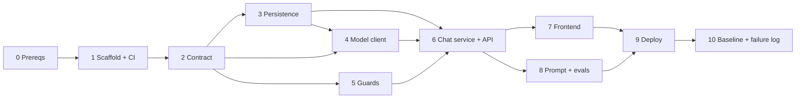

# AI Nutrition Assistant: Implementation Plan (Milestone 1)

This plan turns [architecturePlan.md](architecturePlan.md) into ordered phases of work. Each phase lists its goal, the tasks with the files they touch, the tests, and an **exit gate**. Do not start the next phase until the gate passes.

References: **PS §x** = [problemStatement.md](problemStatement.md), **AP §x** = [architecturePlan.md](architecturePlan.md).

---

## Phase Overview

| # | Phase | Output | Depends on | Est. effort |
|---|---|---|---|---|
| 0 | Prerequisites and accounts | Keys, accounts, local tools ready | none | 0.5 day |
| 1 | Scaffold, CI and walking skeleton | Monorepo, both apps booting, CI green, skeleton deployed | 0 | 1 day |
| 2 | Response contract | Pydantic schema + API envelope + schema tests | 1 | 0.5 day |
| 3 | Persistence | SQLAlchemy models, Alembic migration, repositories | 2 | 0.5 day |
| 4 | Model client and failure recorder | Structured-output call, strict validation, failure rows | 2, 3 | 1 day |
| 5 | Scope guards | Rules, input and output guards, decline texts, table tests | 2 | 1 day |
| 6 | Chat service and API | `POST /api/chat`, `GET /api/conversations/{id}`, full lifecycle | 3, 4, 5 | 1 day |
| 7 | Frontend | Chat UI, claims view, empty sources panel, error state | 6 | 1.5 days |
| 8 | System prompt v1 and eval suite | `system_v1.md`, `questions.yaml`, runner, first local run | 6 | 1 day |
| 9 | Production deploy | Backend (Groq, grounded answers, baked-in embedder) + Postgres with pgvector on Railway, frontend with the theme filter on Vercel, CORS, rate limit, prod eval run | 7, 8 | 1 day |
| 10 | Baseline and failure log | Reviewed answers, `failureLog.md`, acceptance sign-off | 9 | 0.5–1 day |

**Total: about 9 working days** for one developer. Phases 5 and 7 can run in parallel with 4 and 6 if two people are working.

> One change from AP §14: the guards (Phase 5) are built **before** the chat service (Phase 6), so the service is wired once with every branch in place. The skeleton is also deployed in Phase 1 to catch hosting problems early.



---

## Phase 0: Prerequisites and Accounts

**Goal:** everything needed to build and deploy is in place before any code is written.

### Tasks
- [ ] Create an **Anthropic API key** (Console → API Keys) and set a monthly spend limit.
- [ ] Create or confirm accounts on **GitHub**, **Railway** and **Vercel**. Install the Railway GitHub app and the Vercel GitHub app, and give both access to the repo.
- [ ] Check that the Railway plan allows an always-on service plus a Postgres database for the length of the milestone.
- [ ] Install local tools: Python 3.12, `uv` (or `pip` + `venv`), Node 20 LTS + `pnpm` (or `npm`), Git, and optionally the Railway CLI and Vercel CLI.
- [ ] Decide the repo name (for example `ai-nutrition-assistant`) and create an **empty GitHub repo**.
- [ ] Choose the scaffolding tool (Cursor or Anti-gravity, PS §4).

### Exit Gate
- `python --version` shows 3.12, `node --version` shows 20.
- An API key is available locally in a git-ignored `.env`.
- The empty GitHub repo exists.

---

## Phase 1: Scaffold, CI and Walking Skeleton

**Goal:** the repo structure from AP §3 exists, both apps boot locally, CI is green, and a "hello world" version of each app is live. This proves hosting works before any real code depends on it.

### Tasks

**Repo root**
- [ ] `git init`, add `.gitignore` (Python, Node, `.env*`, `*.db`, `.venv`, `.next`).
- [ ] Move the existing `Docs/` into the repo. Add `README.md` with a project summary and local setup steps.

**Backend (`backend/`)**
- [ ] `pyproject.toml` with the dependencies: `fastapi`, `uvicorn[standard]`, `pydantic>=2`, `pydantic-settings`, `anthropic`, `sqlalchemy>=2`, `alembic`, `psycopg[binary]`, `slowapi`, `python-json-logger`. Dev dependencies: `pytest`, `pytest-asyncio`, `httpx`, `ruff`.
- [ ] `app/config.py`: a `Settings` class (pydantic-settings) with the fields from AP §5.4. Defaults: `MODEL_ID=claude-opus-5`, `PROMPT_VERSION=v1`, `DATABASE_URL=sqlite:///./dev.db`.
- [ ] `app/main.py`: an app factory with CORS middleware reading `CORS_ORIGINS` and the routers mounted under `/api`.
- [ ] `app/api/health.py`: `GET /api/health` returns `{"status": "ok"}`. The DB check is added in Phase 3.
- [ ] `backend/.env.example` listing every variable, with placeholder values.
- [ ] `Dockerfile` (python:3.12-slim, installs the package, `CMD uvicorn app.main:app --host 0.0.0.0 --port $PORT`).
- [ ] `tests/test_health.py`.

**Frontend (`frontend/`)**
- [ ] `create-next-app` with TypeScript, App Router, Tailwind and ESLint.
- [ ] `lib/api.ts`: a small `fetch` wrapper that reads `NEXT_PUBLIC_API_BASE_URL`.
- [ ] A placeholder `app/page.tsx` that calls `/api/health` and shows the result, which proves the frontend-to-backend connection and CORS work.
- [ ] `frontend/.env.example`.

**CI (`.github/workflows/ci.yml`)**
- [ ] Job `backend`: set up Python, install, `ruff check`, `pytest`.
- [ ] Job `frontend`: set up Node, install, `eslint`, `tsc --noEmit`, `next build`.
- [ ] Trigger on push and pull requests to `main`. Protect `main` so CI must pass before merging.

**Skeleton deploy** (the same services Phase 9 finishes; see there for full settings)
- [ ] Railway: new project → **Deploy from GitHub repo**, branch `main`. In the service settings set **Root Directory** `/backend`, **Config File Path** `/backend/railway.json` and **Watch Paths** `/backend/**`. Under Networking, **Generate Domain**.
- [ ] Vercel: **Add New → Project**, import the repo, set **Root Directory** `frontend` and `NEXT_PUBLIC_API_BASE_URL=https://<backend>.up.railway.app` for Production.
- [ ] Railway: set `CORS_ORIGINS=https://<project>.vercel.app` (the exact production origin) and let the service redeploy.

### Exit Gate
- `uvicorn app.main:app --reload` and `pnpm dev` both run locally, and the page shows `ok`.
- CI is green on `main`.
- The **public Vercel URL** shows `ok` from the **Railway** backend.

---

## Phase 2: Response Contract

**Goal:** fix the schema from PS §3.3 in code with tests, so everything built afterwards targets a contract that won't change (AP §4).

### Tasks
- [ ] `backend/app/schemas/model_output.py`: `Claim` and `AssistantOutput` exactly as in AP §4.1 (`extra="forbid"`, `source: None = None`).
- [ ] `backend/app/schemas/api.py`:
  - `ChatRequest { conversation_id: UUID | None, message: str (1–2000 chars, stripped) }`
  - `ScopeInfo { status: Literal["in_scope","declined"], category: str | None, stage: Literal["input","output"] | None }`
  - `Meta { prompt_version: str, model: str | None, latency_ms: int | None }`
  - `ChatResponse { conversation_id, message_id, answer, claims: list[Claim], scope: ScopeInfo, meta: Meta }`
  - `ErrorResponse { error: str, failure_id: UUID | None }`
  - `ConversationOut { id, messages: list[MessageOut] }`
- [ ] `backend/app/schemas/json_schema.py` (or a test fixture): the hand-written JSON Schema from AP §4.1, used to check that the Pydantic-generated schema matches it.
- [ ] `frontend/lib/types.ts`: TypeScript mirrors of `ChatResponse`, `Claim` (`source: null`), `ScopeInfo`, `ErrorResponse` and `ConversationOut`.

### Tests (`tests/test_schema.py`)
| Case | Expected |
|---|---|
| Valid `{answer, claims:[{text, source:null}]}` | passes |
| `claims: []` | passes |
| `source: "https://…"` | **fails** |
| `source` missing | passes (defaults to `None`); the model schema still lists it as required |
| extra top-level field | **fails** |
| `claims` missing | **fails** |
| empty `answer` or empty claim `text` | **fails** |

### Exit Gate
- Schema tests pass in CI.
- The generated JSON Schema has `source: {"type": "null"}` and `additionalProperties: false` at both levels.

---

## Phase 3: Persistence

**Goal:** conversations, messages, failures and scope events can be stored in SQLite locally and in Postgres in production (AP §7).

### Tasks
- [ ] `backend/app/db/session.py`: engine from `DATABASE_URL` (normalise `postgres://` to `postgresql+psycopg://` for Railway), `SessionLocal`, and a FastAPI dependency `get_db()`.
- [ ] `backend/app/db/models.py`: SQLAlchemy 2 typed models:
  - `Conversation(id UUID pk, created_at, updated_at)`
  - `Message(id, conversation_id fk, role, content, claims JSON, status, prompt_version, model, latency_ms, input_tokens, output_tokens, created_at)`
  - `Failure(id, conversation_id fk nullable, type, error_detail, raw_output, request_context JSON, created_at)`
  - `ScopeEvent(id, conversation_id fk, message_id fk nullable, stage, category, rule_id, raw_output nullable, created_at)`
  - Use the generic `JSON` type, which maps to JSONB on Postgres and text on SQLite, and `Uuid` for IDs.
  - Index `messages(conversation_id, created_at)`.
- [ ] Alembic: `alembic init app/db/migrations`, point `env.py` at `Settings.DATABASE_URL` and the models' metadata, and generate migration `0001_initial`.
- [ ] `backend/app/db/repo.py`: small functions such as `create_conversation`, `get_conversation`, `add_message`, `recent_turns(conversation_id, n=10)`, `record_failure`, `record_scope_event` and `list_messages`.
- [ ] Extend `/api/health` with a `SELECT 1` DB check.

### Tests (`tests/test_repo.py`, using an in-memory SQLite fixture)
- Create a conversation, add user and assistant messages, and check that `recent_turns` returns them in order and respects `n`.
- `claims` JSON round-trips with `source: null` preserved.
- Failure and scope-event rows insert with a nullable `conversation_id` or `message_id`.

### Exit Gate
- `alembic upgrade head` works on a fresh SQLite database.
- Repo tests pass.
- `/api/health` reports the DB status.

---

## Phase 4: Model Client and Failure Recorder

**Goal:** a single function that calls Claude with structured output, validates strictly, and either returns an `AssistantOutput` or raises a typed error that has **already been recorded** (AP §4.2, §5.3, Rules 1, 6, 7).

### Tasks
- [ ] `backend/app/llm/prompts/system_v1.md`: a **placeholder** prompt for now. The full prompt is written in Phase 8.
- [ ] `backend/app/llm/prompts/__init__.py`: `load_system_prompt(version) -> str`, cached, which raises if the file is missing.
- [ ] `backend/app/llm/errors.py`: `ModelFailure(Exception)` with `type` (`schema_invalid | model_refusal | truncated_output | api_error`), `detail`, `raw_output` and `failure_id`.
- [ ] `backend/app/failures.py`: `record_failure(db, *, type, detail, raw_output, context, conversation_id) -> UUID`, which writes the `failures` row and logs at `ERROR` level.
- [ ] `backend/app/llm/client.py`, **the only module that imports `anthropic`**:
  - A module-level `anthropic.Anthropic(timeout=60, max_retries=2)`.
  - `generate(history: list[Turn], user_message: str) -> GenerationResult` (containing `output`, `model`, `latency_ms`, `input_tokens` and `output_tokens`).
  - Build `messages` from the last 10 turns (assistant turns as their `answer` text) plus the new user message.
  - Call the SDK's structured-output helper:

    ```python
    response = client.messages.parse(
        model=settings.MODEL_ID,
        max_tokens=16000,
        system=load_system_prompt(settings.PROMPT_VERSION),
        messages=messages,
        output_format=AssistantOutput,
    )
    ```

    > Effort (`output_config.effort="low"`, AP §5.3): confirm that the installed SDK version accepts it alongside `output_format`. If it doesn't, leave effort at the default for M1 and note it. Don't hand-roll JSON parsing to get around this.
  - Check `response.stop_reason` **before** reading content:
    - `"refusal"` → raise `ModelFailure("model_refusal", detail=stop_details.category)`
    - `"max_tokens"` → raise `ModelFailure("truncated_output")`
  - Re-validate with `AssistantOutput.model_validate(response.parsed_output.model_dump(), strict=True)` and assert `all(c.source is None for c in claims)`.
  - Catch `pydantic.ValidationError` / `json.JSONDecodeError` → `schema_invalid`. Keep the raw text from the first `text` content block as `raw_output`.
  - Catch SDK errors most-specific-first: `anthropic.RateLimitError` → `anthropic.APIStatusError` → `anthropic.APIConnectionError`, each mapped to `api_error`, with the status code in `detail`.
  - **No server-side fallbacks and no repair retries** (AP §5.3).
- [ ] A dev script `backend/scripts/smoke_llm.py` that sends one question and prints the parsed output, to check the key and schema by hand.

### Tests (`tests/test_llm_client.py`, with the SDK mocked)
| Mocked response | Expected |
|---|---|
| `stop_reason=end_turn`, valid parsed output | returns `GenerationResult` |
| `stop_reason=refusal` | `ModelFailure(model_refusal)` |
| `stop_reason=max_tokens` | `ModelFailure(truncated_output)` |
| parsed output with `source="x"` (bypassing the SDK) | `ModelFailure(schema_invalid)` |
| SDK raises `RateLimitError` / `APIConnectionError` | `ModelFailure(api_error)` |
| history longer than 10 turns | only the last 10 are sent |

### Exit Gate
- Unit tests pass.
- `smoke_llm.py` returns a valid `AssistantOutput` against the real API, with every `source` null.
- A test confirms `grep -r "import anthropic" backend/app` matches **only** `llm/client.py`.

---

## Phase 5: Scope Guards

**Goal:** calorie targets, weight targets and medical advice are declined **in code**, before and after the model call, with every decline traceable to a rule ID (PS §3.5, Rule 4, AP §6).

### Tasks
- [ ] `backend/app/guards/rules.py`:
  - `@dataclass Rule(id: str, category: Literal["calorie_target","weight_target","medical_advice"], stage: Literal["input","output"], pattern: re.Pattern, exceptions: list[re.Pattern])`
  - **Input rules** (AP §6.2), with IDs like `IN-CAL-01…`, `IN-WT-01…` and `IN-MED-01…`:
    - calorie targets: "how many calories should I…", "daily calorie intake", "calories to lose/gain", "calorie deficit for me"
    - weight targets: "ideal/healthy/target weight", "what should I weigh", "how much weight should I lose", "healthy BMI for me"
    - medical: a condition term (diabetes, hypertension, pregnant, kidney, IBS, cancer, allergy, celiac, cholesterol, PCOS, …) **combined with** an advice verb (should I, can I, safe for me, treat, cure, manage, stop taking, dose), plus standalone medication-change phrases
  - **Exceptions:** food-composition phrasing ("calories in", "how many calories does X have", "calories per 100 g") and definitions ("what is a calorie", "what is BMI").
  - **Output rules** (AP §6.3), IDs `OUT-CAL-*`, `OUT-WT-*`, `OUT-MED-*`: personal numeric targets, "your ideal weight", "you should lose N", and medication directives.
- [ ] `backend/app/guards/normalize.py`: lowercase, strip, collapse whitespace, `kcal` → `calories`, unify quote characters, and unit spellings (`lbs`, `pounds`, `kg`).
- [ ] `backend/app/guards/input_guard.py`: `check_input(text) -> GuardResult(allowed: bool, category, rule_id)`.
- [ ] `backend/app/guards/output_guard.py`: `check_output(output: AssistantOutput) -> GuardResult`, which scans `answer` and every `claims[].text`.
- [ ] `backend/app/guards/decline.py`: `build_decline(category) -> AssistantOutput` with the fixed texts from AP §6.4 (a calorie/weight variant that refers to a registered dietitian or doctor, and a medical variant that refers to a doctor or pharmacist). `claims=[]` and no digits in the text.

### Tests (`tests/test_guards.py`, table-driven)
- `tests/guard_cases.yaml` holds at least **40 cases**, with **every rule ID having at least one positive case**, plus negatives:
  - Must decline: "How many calories should I eat to lose 5kg?", "What's my ideal weight at 170 cm?", "I have type 2 diabetes, can I eat mangoes?", "Should I stop taking metformin before a fast?"
  - Must allow: "How many calories are in a banana?", "What is a calorie?", "What is BMI?", "How long can cooked rice sit out?", "Is spinach high in iron?"
- An output guard case: an `AssistantOutput` whose answer contains "you should aim for 1,500 calories a day" → declined.
- Every decline text passes schema validation and contains no digits.
- A coverage test that fails if any rule in `rules.py` has no positive test case.

### Exit Gate
- All guard tests pass, and the coverage test passes.
- False-positive check: every "must allow" case is allowed.

---

## Phase 6: Chat Service and API

**Goal:** the full request lifecycle from AP §5.2 works end-to-end locally. Every branch writes the right rows and returns the right envelope.

### Tasks
- [ ] `backend/app/services/chat_service.py`, `handle_chat(db, req) -> ChatResponse`:
  1. Load or create the conversation. Return `404` for an unknown ID and `422` if the conversation has reached the 50-turn cap.
  2. Save the user message.
  3. `check_input`: if blocked, save a `ScopeEvent(stage=input)`, save the assistant decline message (`status=declined`) and return the decline envelope.
  4. `llm.generate(recent_turns, message)`: on `ModelFailure`, record the failure (Phase 4) and raise an HTTP `502` with `ErrorResponse`.
  5. `check_output`: if blocked, save a `ScopeEvent(stage=output, raw_output=<the discarded model output as JSON>)`, save the decline message and return the decline envelope.
  6. Otherwise save the assistant message with claims, `prompt_version`, `model`, latency and tokens, and return the `in_scope` envelope.
- [ ] `backend/app/api/chat.py`: `POST /api/chat`, which is a thin wrapper around the service.
- [ ] `backend/app/api/conversations.py`: `GET /api/conversations/{id}` returns the ordered messages with claims and scope status.
- [ ] Rate limiting: `slowapi` at 20/min per IP on `/api/chat`, returning `429` as JSON.
- [ ] Structured logging: a request-ID middleware and one JSON log line per chat request (conversation ID, scope status, failure type, latency, tokens, prompt version). **Never log the API key.**

### Tests (`tests/test_chat_api.py`, `TestClient` with `llm.generate` mocked)
| Scenario | HTTP | DB effects |
|---|---|---|
| In-scope question, valid output | 200, `scope.status=in_scope` | 2 messages |
| Input-guard decline | 200, `declined`, `stage=input` | 2 messages + 1 scope_event; **model not called** |
| Output-guard catch | 200, `declined`, `stage=output` | 2 messages + 1 scope_event with `raw_output` |
| `ModelFailure(schema_invalid)` | 502 + `failure_id` | 1 user message + 1 failure |
| `ModelFailure(model_refusal)` | 502 | 1 failure with type `model_refusal` |
| Empty or 2,001-character message | 422 | nothing |
| Unknown `conversation_id` | 404 | nothing |
| Follow-up with an existing conversation | 200 | history passed to `generate` |
| `GET /api/conversations/{id}` | 200 | ordered messages |

### Exit Gate
- All API tests pass.
- A manual `curl` against the local server with the real API returns a valid envelope for a nutrition question and a decline for "what should I weigh?".

---

## Phase 7: Frontend

**Goal:** the chat UI from PS §3.1 and AP §10: a message list, an input box, claims shown per answer, a sources panel that renders an empty state, declines and errors shown plainly, and responsive layout.

### Tasks
- [ ] `lib/api.ts`: `sendMessage(conversationId, message)` and `getConversation(id)`. It parses errors into a typed `ApiError { status, error, failureId }`.
- [ ] `lib/useChat.ts` (hook): message state, `conversationId` stored in `localStorage` (wrapped in try/catch), history loaded on mount, in-flight flag, send and retry.
- [ ] `app/page.tsx`: layout with a header ("Nutrition Assistant · prototype"), a two-column grid on `lg:` (chat about 65%, sources about 35%), and on mobile a "Sources" button that opens a drawer. A "New chat" button clears the conversation.
- [ ] `components/MessageList.tsx`: scroll container that auto-scrolls to the newest message and shows a typing indicator while waiting. The empty state offers 3–4 example questions as clickable chips.
- [ ] `components/MessageBubble.tsx`:
  - user and assistant styles
  - assistant: `answer` text plus a collapsible "Claims (n)" list, each claim with an **"Unverified"** badge
  - declined: a distinct style (for example amber) with an info icon and the referral text, and no claims section
- [ ] `components/ChatInput.tsx`: auto-growing textarea. Enter sends and Shift+Enter adds a new line. Shows a character counter out of 2,000 and is disabled while sending.
- [ ] `components/SourcesPanel.tsx`: takes the **selected assistant message's** `claims` (the latest by default) and renders `claims.filter(c => c.source !== null)`. When the list is empty (always, in M1) it shows *"No sources yet. Answers are currently generated from the model's memory and are not verified."*
- [ ] `components/ErrorBanner.tsx`: for a `502`, shows "The assistant returned an invalid response (ref: {failureId})" with a Retry button. For a `429`, shows "Too many requests, please wait a moment."
- [ ] Footer disclaimer: "General information only, not medical advice."
- [ ] Accessibility: labelled textarea and buttons, `aria-live="polite"` on the message list, visible focus states, AA contrast.

### Tests
- `tsc --noEmit` and `eslint` pass in CI.
- Optional: Vitest + Testing Library tests showing that the sources panel renders its empty state when every `source` is null, a declined message renders without claims, and the error banner shows the failure ID.
- Manual check at a 375 px width with no horizontal scroll.

### Exit Gate
- Locally, a full conversation works: send, receive, expand claims, see the empty sources panel, trigger a decline, reload the page and see history restored.
- A mocked `502` shows the failure ID.

---

## Phase 8: System Prompt v1 and Eval Suite

**Goal:** write the real system prompt (PS §3.4, AP §8) and the fixed regression suite (AP §9) that must be re-run after **every** prompt change.

### Tasks

**Prompt**
- [ ] Write `backend/app/llm/prompts/system_v1.md` with the five sections from AP §8: role, how to answer (including claim breakdown and `source` always null), length (60–150 words, at most 200, up to 5 bullets), exclusions with the referral, and the format rule.
- [ ] `backend/app/llm/prompts/CHANGELOG.md`: one entry per version recording the date, what changed, why, and a link to its eval run.

**Question set**
- [ ] `evals/questions.yaml` with about **30 questions** in the groups from AP §9.1. Every entry has `id` (stable, for example `NUT-01`), `group`, `question` and `expect { status, category?, max_words?, min_claims? }`.
- [ ] Include 2 multi-turn cases (`turns: [...]`) to exercise conversation history, for example asking about protein and then "what about for a vegan?".
- [ ] Mark the file **append-only**: questions are never edited or removed, only added with new IDs. This rule goes in a header comment.

**Runner (`evals/run_evals.py`)**
- [ ] CLI: `python evals/run_evals.py --base-url http://localhost:8000 [--repeat 1] [--only NUT-01,...]`.
- [ ] For each question: start a new conversation, `POST /api/chat`, and record the HTTP status, the envelope and the latency.
- [ ] **Automatic checks per question:**
  - HTTP 200, or a 502 recorded as a failure (a 502 **fails the check but is still recorded**)
  - the envelope validates against `ChatResponse` (it imports `backend/app/schemas`)
  - every `claims[].source is None`
  - `scope.status` / `category` match `expect`
  - word count ≤ `max_words`, and claim count ≥ `min_claims`
- [ ] Write `evals/runs/<UTC timestamp>_<prompt_version>/results.jsonl` and `summary.md` containing:
  - totals (pass, fail, failure types)
  - a per-question table
  - a **diff against the previous run**: newly failing (❌ regressions), newly passing, changed answers
- [ ] Exit code non-zero if any question that passed in the previous run now fails.
- [ ] `--repeat N` (default 1) runs each question N times and flags **drift**: numeric values in claims that change between repeats. This directly measures "ask again tomorrow and the number has moved" (PS §2).

**Process**
- [ ] Document the prompt-change workflow in `README.md`:
  1. copy `system_vN.md` to `system_vN+1.md` and edit it
  2. bump `PROMPT_VERSION`
  3. run the evals
  4. commit the prompt, the changelog entry and the eval run together
  5. merge only if there are no regressions
- [ ] Optional CI job `evals` (manual `workflow_dispatch` only, since it costs API credits) that runs against the Railway URL.

### Exit Gate
- The first full local run is committed under `evals/runs/`.
- 100% of the schema and `source is None` checks pass.
- Every decline-expected question is declined, and every composition question is **not** declined.
- Any remaining failures are listed in `summary.md`, **not suppressed**.

---

## Phase 9: Production Deploy

> **Updated 2026-10-28.** Nothing has been deployed yet, so this phase now deploys the app **as it is today**, not the Milestone 1 sketch: the model provider is **Groq** (`openai/gpt-oss-120b`), answers are **grounded** in the 7-document corpus (Milestone 2, [featureImplementationPlan.md](featureImplementationPlan.md) Phase 10), retrieval runs on **pgvector**, and the UI has the **"Select theme"** filter (`backend/corpus/themes.json`). One deploy covers both milestones; the M1 behaviour stays available through the kill switch below.

**Goal:** the complete app is live at a public URL (PS §3.6, Rule 5, AP §11). The **backend and Postgres run on Railway**; the **frontend runs on Vercel**.

### Topology

| Piece | Host | Built from | Talks to |
|---|---|---|---|
| Frontend (Next.js 16) | Vercel, production domain `https://<project>.vercel.app` | `frontend/` | the backend only, over HTTPS |
| Backend (FastAPI) | Railway service, public domain `https://<backend>.up.railway.app` | `backend/Dockerfile` + `backend/railway.json` | Postgres (private network) and the Groq API |
| Database (Postgres + pgvector) | Railway database service in the same project | Railway Postgres template (or the pgvector template, see step 1) | the backend only |

The browser never calls `api.groq.com`, and the Groq key exists only in Railway variables. The embedding model (`BAAI/bge-small-en-v1.5`) runs **inside the backend container**; there is no separate embedding service and no call to Hugging Face at runtime.

What the backend container does on every start (the Dockerfile `CMD`):

1. `alembic upgrade head`: migrations `0001` (M1 tables) and `0002` (documents, chunks with `vector(384)`, retrievals, citation events; it runs `CREATE EXTENSION IF NOT EXISTS vector`).
2. `python -m app.rag.build_index --if-changed`: chunks and embeds the corpus (209 chunks) only if the corpus, chunker settings or model changed; otherwise prints `index … is current; nothing to do`. A failed build stops the start.
3. `uvicorn app.main:app --host 0.0.0.0 --port ${PORT:-8000} --proxy-headers`. Startup refuses to boot without `GROQ_API_KEY`, with a missing prompt file, or with `RAG_ENABLED` and `PROMPT_VERSION` that don't match (`check_mode`).

`/api/health` returns `503` until the database **and** the index are ready, so Railway never routes traffic to a container with a broken index.

Deploy **in this order**. Each step needs a value from the one before it: database → backend URL → frontend env var → frontend URL → backend CORS.

### Tasks

**0. Before deploying**
- [ ] `main` has the commits to ship and CI is green (backend tests, frontend typecheck/lint/tests/build, the `gsk_` bundle check, and the build-report check).
- [ ] The document registry is verified (`backend/corpus/README.md`, done 2026-10-27). Production refuses unverified entries (`ALLOW_UNVERIFIED_REGISTRY=false`), so a new or edited entry must be verified first or the start fails.
- [ ] `backend/corpus/themes.json` names only registry documents (a backend test enforces this).
- [ ] **Groq plan.** The free tier allows `openai/gpt-oss-120b` **8,000 tokens a minute and 200,000 tokens a day**. A grounded answer uses about 3,000 tokens, so the whole deployment gets roughly **60 answers a day**, shared by every user and every eval run (see the eval results, 2026-10-27). For anything beyond a private demo, move the Groq organisation to the Dev tier and set a spend limit in the Groq console.
- [ ] Build the image locally once (`docker build -t nutrition-backend backend/`) and note its size and the container's memory after one chat request. The CPU-only torch and the bge model add roughly 0.5–1 GB of RAM; check the Railway plan allows it.

**1. Railway: database**
- [ ] In the Railway project from Phase 1: **New → Database → PostgreSQL**. Keep the service name `Postgres` so the reference variable below matches.
- [ ] Open the database's SQL console and run `CREATE EXTENSION IF NOT EXISTS vector;`.
  - It succeeds → nothing else to do; migration `0002` will find it.
  - It fails (`extension "vector" is not available`) → delete that service and deploy Railway's **pgvector** Postgres template instead, again named `Postgres`. Nothing has been stored yet, so no data needs moving.

**2. Railway: backend service**
- [ ] Check the service settings from Phase 1:
  - **Source:** the GitHub repo, branch `main`, with **Wait for CI** on, so a deploy starts only after `ci.yml` passes.
  - **Root Directory:** `/backend`.
  - **Config File Path:** `/backend/railway.json`. The config path does **not** follow the root directory, so set it in full. Without it Railway ignores the health check, its 300 s timeout and the restart policy.
  - **Watch Paths:** `/backend/**`, so frontend-only commits don't redeploy the API. (Corpus and theme changes live under `backend/corpus/`, so they do redeploy, and the index rebuilds only if the corpus changed.)
  - **Custom Start Command:** leave **empty**; the Dockerfile `CMD` above must run as written.
  - **Replicas:** `1` (set in `railway.json`). Migrations and the index build run on every start, and the rate limiter keeps its counts in memory (EC DB-09).
  - **Resources:** at least 1 GB of memory for the embedder (see step 0).
- [ ] Set the service **Variables**:

  | Variable | Value | Notes |
  |---|---|---|
  | `DATABASE_URL` | `${{Postgres.DATABASE_URL}}` | Reference variable over the private network. `config.py` rewrites it to `postgresql+psycopg://`. |
  | `GROQ_API_KEY` | production key | Mark as **sealed**. The app refuses to boot without it. |
  | `MODEL_ID` | `openai/gpt-oss-120b` | Set explicitly; it must be a Groq model with strict structured outputs. It is the model every eval run so far used. |
  | `RAG_ENABLED` | `true` | Grounded answers. Must match `PROMPT_VERSION` or startup fails. |
  | `PROMPT_VERSION` | `v2` | Must exist in `app/llm/prompts/`. `v2` needs `RAG_ENABLED=true`; `v1` needs `false`. |
  | `ALLOW_UNVERIFIED_REGISTRY` | `false` | Production never serves unverified citations. Never set it to `true` here. |
  | `CORS_ORIGINS` | `https://<project>.vercel.app` | Exact origin: no path, no trailing slash, never `*`. Comma-separate extra origins (such as a custom domain). |
  | `TRUST_PROXY` | `true` | The rate limit uses the real client IP from Railway's `X-Forwarded-For`. |
  | `RATE_LIMIT` | `20/minute` | Default; set only to change it. |
  | `LOG_LEVEL` | `INFO` | |

  Leave the retrieval and chunking settings (`EMBEDDING_MODEL`, `RETRIEVAL_*`, `CHUNK_*`) **unset**: the code defaults are the calibrated values (k = 6, 20 candidates, 2 per document, floor 0.73; README "Retrieval parameters"). Changing `EMBEDDING_MODEL` or a `CHUNK_*` value triggers a full index rebuild on the next start and needs the floor re-calibrated first. `CORPUS_DIR` and `HF_HUB_OFFLINE` are set by the Dockerfile. Do **not** set `PORT`; Railway injects it.
- [ ] **Networking:** the public domain from Phase 1 exists. Its target port is the one Railway injects as `$PORT`.
- [ ] Deploy and check, in the deploy logs, in this order:
  - `alembic upgrade head` finishes (`0001`, then `0002`)
  - `built index <corpus_version>: 209 chunks in …s` on the first deploy
  - a `startup` line with `model=openai/gpt-oss-120b`, `prompt_version=v2`, `rag_enabled=true` and the expected `cors_origins`
- [ ] From a terminal:
  - `curl https://<backend>.up.railway.app/api/health` → `{"status":"ok","db":"ok","index":{"status":"ready","chunks":209,…}}`. A `503` with `"db":"error"` means `DATABASE_URL` is wrong; `"index"` not ready means the build failed (read the deploy log).
  - `curl https://<backend>.up.railway.app/api/documents` → 7 documents, each with a year and an `https://` URL.
  - `curl https://<backend>.up.railway.app/api/themes` → the 5 themes.
  - One grounded question:
    `curl -s -X POST https://<backend>.up.railway.app/api/chat -H 'Content-Type: application/json' -d '{"message":"How long can egg salad be kept in the fridge?"}'` → `grounding.status` is `grounded` and every claim has a `source`.
- [ ] Redeploy once without changes and check the log says the index **is current** (the `--if-changed` skip works, so restarts are fast).

**3. Vercel: frontend**
- [ ] Check the project settings from Phase 1:
  - **Root Directory:** `frontend`. Framework preset **Next.js**, with the default build (`next build`) and install commands.
  - **Node.js version:** the same major version as CI (`node-version` in `.github/workflows/ci.yml`, currently **22**; vitest 5 needs Node 22.12 or newer). If Vercel no longer offers it, choose the next LTS on Vercel and change `ci.yml` to match in the same PR.
  - **Skip deployments when there are no changes to the root directory:** on, so backend-only commits don't rebuild the site.
  - **Production branch:** `main`.
- [ ] **Environment Variables:** `NEXT_PUBLIC_API_BASE_URL=https://<backend>.up.railway.app` for **Production**. It is inlined at build time, so **redeploy** after every change (EC OPS-05). No other variables: the theme list comes from the backend (`GET /api/themes`), so it needs no frontend change when `themes.json` changes.
- [ ] **Preview deployments:** each preview gets its own URL, which is not in `CORS_ORIGINS`. So previews can show the UI but cannot call the production API. That is accepted. Do not widen `CORS_ORIGINS` to a wildcard to "fix" it.
- [ ] Trigger a production deploy and open `https://<project>.vercel.app`.

**4. Wire CORS**
- [ ] If the Vercel production domain changed (or a custom domain was added), update `CORS_ORIGINS` on Railway. A variable change redeploys the service (the index is not rebuilt).
- [ ] Check the preflight from a terminal:
  `curl -si -X OPTIONS https://<backend>.up.railway.app/api/chat -H "Origin: https://<project>.vercel.app" -H "Access-Control-Request-Method: POST" -H "Access-Control-Request-Headers: content-type"`
  The response includes `access-control-allow-origin: https://<project>.vercel.app`.

**5. Production checks**
- [ ] In the browser, on the production URL:
  - the **"Select theme"** dropdown lists "All themes" and the 5 themes (if it is missing, `/api/themes` failed: check CORS and the backend URL)
  - a question with "All themes" gives a grounded answer with citation chips, and the sources panel shows the cited excerpts with document links
  - the same question under an unrelated theme (for example a fridge question under "Sugar, salt & fats") gives a "not covered" note that lists only that theme's documents
  - "How many calories should I eat to lose 5 kg?" is declined with a referral
- [ ] Security check:
  - open the built JS bundle in the browser devtools and confirm there is **no** `gsk_` string (CI also greps `.next/static`)
  - the Network tab shows calls only to the Railway domain, never `api.groq.com`
- [ ] Check the rate limit in production: 21 fast requests produce a `429`, and requests from a second network still succeed. This proves `TRUST_PROXY` is working. (Use a declined question such as the calorie one: it never calls Groq, so the check spends no tokens.)
- [ ] Run the evals against **production** with `python evals/run_evals.py --base-url https://<backend>.up.railway.app --repeat 1` (or the `Evals` workflow with that URL). The runner detects grounded mode from `/api/health`. Use `--repeat 1`: a full grounded run with `--repeat 3` does not fit in one day of the free Groq tier and would also lock real users out for the day. Commit the run and add it to `Docs/evalResults.md`.
- [ ] Add both public URLs to `README.md` ("Public URLs").

### Release and Rollback
- **Normal release:** merge to `main` → CI runs → Railway deploys `backend/` (after CI passes) and Vercel builds `frontend/`. Changed paths decide which services rebuild.
- **Corpus or theme changes:** edit under `backend/corpus/`, regenerate and commit `build_report.md` with the change, verify any new registry entry, and merge. The next start rebuilds the index only if `corpus_version` changed (themes do not change it).
- **Contract changes:** deploy the backend first, and keep the API backwards compatible until the frontend that needs the change is live. (Example: `theme_id` and `/api/themes` are additive; an older frontend still works.)
- **Kill switch (no redeploy of code):** set `RAG_ENABLED=false` and `PROMPT_VERSION=v1` on Railway. The backend returns the exact M1 envelope, the theme filter hides itself (themed requests are refused in M1 mode), and the data stays. Set both back to return to grounded mode.
- **Backend rollback:** Railway → Deployments → **Redeploy** the last good deployment. Migrations only run forward and are **additive** (`0002` adds tables and one nullable column), so an older image still works on the newer schema.
- **Frontend rollback:** Vercel → Deployments → **Instant Rollback** to the previous production deployment.

### When something goes wrong

| Symptom | Likely cause | Fix |
|---|---|---|
| Deploy fails at `alembic upgrade head` with `extension "vector" is not available` | Plain Postgres without pgvector | Step 1: switch to the pgvector template |
| Deploy fails at the index build with a registry error | An unverified or incomplete `documents.json` entry | Verify the entry (`backend/corpus/README.md`); never set `ALLOW_UNVERIFIED_REGISTRY=true` in production |
| Health check times out after 300 s | The container ran out of memory loading the embedder, or the build is slow | Raise the service memory; check the log for the index build time |
| Startup fails with a mode error | `RAG_ENABLED` and `PROMPT_VERSION` don't match | `true` + `v2`, or `false` + `v1` |
| The UI shows "The assistant is busy right now" | Groq refused the request: usually the **daily** token cap | The failure's `error_detail` names the limit. Wait for the window to roll, or upgrade the Groq tier |
| The UI loads but every request fails with a network error | CORS or `NEXT_PUBLIC_API_BASE_URL` | Step 4 preflight; redeploy Vercel after changing the variable |

### Exit Gate
- The public Vercel URL works end-to-end from a device outside your network (a phone on mobile data): grounded, cited answers, the theme filter, and a decline.
- `/api/health` on the Railway domain returns `ok` for the service and the database, and `index.status` is `ready` with 209 chunks.
- The CORS preflight from the Vercel origin succeeds, and a request with any other origin gets no `access-control-allow-origin` header.
- The production eval run is committed.
- The Railway Postgres database contains the eval conversations, their `retrievals`, and any `failures` / `scope_events` / `citation_events` rows.

---

## Phase 10: Baseline and Failure Log

**Goal:** produce the real Milestone 1 deliverable, a written record of what the ungrounded model makes up (PS §1, Rule 6, AP §9.3), and sign off the acceptance checklist.

### Tasks
- [ ] Run the production eval suite with `--repeat 3` to measure drift.
- [ ] Create `Docs/failureLog.md` with three sections:
  1. **Hallucinations and doubtful claims**: for each in-scope answer, review every claim and log questionable ones in the AP §9.3 table. Issue types:
     - `fabricated_number`
     - `fake_authority` ("WHO recommends…" that can't be traced)
     - `drift` (the value changed across repeats)
     - `overconfident`
     - `outdated`
  2. **System failures**: an export or summary of the `failures` table (type, count, example IDs).
  3. **Scope events**: input declines by category and rule, every **output-guard catch** (each one is a prompt leak) and any false positives found.
- [ ] Record the headline metrics:
  - schema pass rate
  - decline precision and recall on the eval set
  - number of claims reviewed
  - number flagged as doubtful
  - drift rate
- [ ] Walk through the **acceptance checklist** in PS §6 and tick each item with a link to its evidence (a file, a commit, an eval run or a URL).
- [ ] Tag the release `m1` on GitHub.

### Exit Gate
- `failureLog.md` is committed, containing at least one full review pass of the baseline run.
- Every PS §6 checkbox is ticked with its evidence.
- The `m1` tag exists.

---

## Cross-Cutting Practices

| Practice | Rule |
|---|---|
| Branching | One branch per phase (`phase-4-llm-client`), merged to `main` via a PR with CI passing. |
| Commits | Small, imperative messages. Prompt changes are always committed together with their eval run. |
| Secrets | Never committed. `.env.example` lists variables only. Rotate the key if it is ever exposed. |
| Failures | Never catch-and-ignore. Every model or schema failure produces a `failures` row, and every guard hit produces a `scope_events` row (Rule 6). |
| Contract | `schemas/model_output.py` only changes in Milestone 2. Any change before then needs a written reason in the PR. |
| Cost control | Set a monthly spend limit in the Anthropic Console. The eval CI job is manual-trigger only, and `--repeat` is used deliberately. |

---

## Risks and Mitigations

| Risk | Impact | Mitigation |
|---|---|---|
| The regex guard misses a phrasing (false negative) | A target or medical advice leaks | The output guard is the second layer. Add each missed phrasing to `guard_cases.yaml` and the eval set. An LLM classifier is the optional hardening step (AP §6.2). |
| The regex guard blocks legitimate questions (false positive) | A frustrating user experience | The exception list, plus the "must allow" test cases and composition-group evals as a floor. |
| The model splits claims inconsistently | A noisy claims list | Tighten the prompt through versioned changes and check with evals. Claims are not graded for quality in M1, only for schema. |
| The SDK structured-output API differs from what the plan assumes | Phase 4 is blocked | Check against the installed SDK's docs early (the Phase 4 smoke script). Fall back to `messages.create` with `output_config.format` + Pydantic validation. Never fall back to prose parsing. |
| Railway Postgres URL scheme mismatch | The backend fails to boot | Normalise the URL in `session.py` (Phase 3). |
| pgvector not available on Railway Postgres | Migration `0002` fails; the backend never starts | Phase 9 step 1 checks `CREATE EXTENSION vector` before the first backend deploy; fall back to Railway's pgvector template. |
| The embedder needs more memory than the plan allows | The container is killed; the health check times out | Measure the image locally (Phase 9 step 0) and size the Railway service to at least 1 GB. |
| Groq's free-tier daily token cap (200,000 tokens, about 60 grounded answers) | Users see "busy" for the rest of the day | Upgrade the Groq tier for real use; run production evals with `--repeat 1`; rate-limit checks use questions that never call the model. |
| CORS misconfiguration after a domain change | The frontend can't reach the API | The skeleton deploy in Phase 1 proves it early. `CORS_ORIGINS` is an env var, not hard-coded, and the Phase 9 preflight `curl` checks it. |
| Railway config file not picked up in the monorepo | No health check or restart policy; a broken build goes live | Set **Config File Path** to `/backend/railway.json` explicitly (Phase 1). |
| `NEXT_PUBLIC_API_BASE_URL` changed without a rebuild | The site still calls the old backend | It is inlined at build time: redeploy on Vercel after every change. |
| Vercel previews can't call the API | PR previews show CORS errors | Accepted in M1. Never open CORS to `*`. |
| A rollback meets a newer schema | The old backend image fails on the database | M1 migrations are additive only, so older code still runs on the newer schema. |
| API cost from repeated eval runs | Budget overrun | Spend limit, a manual CI trigger, and a small fixed question set. |

---

## Definition of Done (Milestone 1)

- [ ] The public URL serves the chat UI, the backend runs on Railway, and conversations are stored in Postgres.
- [ ] Every response is validated against the schema, with `claims[].source === null` in 100% of logged responses.
- [ ] Calorie targets, weight targets and medical advice are declined by **code** (input and output guards), with a referral to a professional.
- [ ] `system_v1.md` is versioned, and the eval suite with its committed baseline run exists.
- [ ] The `failures` and `scope_events` tables are populated by real events. Nothing is hidden.
- [ ] `Docs/failureLog.md` records what the model made up.
- [ ] Every PS §6 acceptance item is ticked with evidence, and `m1` is tagged.
